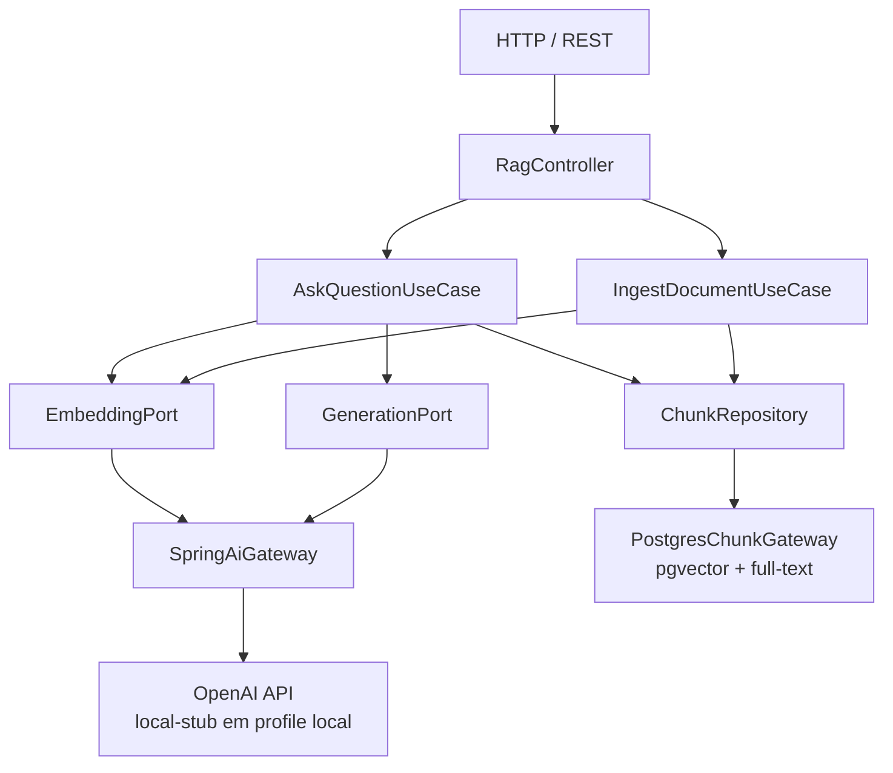

# Enterprise RAG Java

**Repositório:** [github.com/charlespaivadeveloper/enterprise-rag-java](https://github.com/charlespaivadeveloper/enterprise-rag-java)
**Versão atual:** v0.1.1

---

## Problema

Construir uma referência de RAG (Retrieval-Augmented Generation) com isolamento multi-tenant real, retorno de citações rastreáveis e proteção contra injeção de prompt — sem depender de um stack de busca dedicado separado do banco de dados transacional.

---

## Arquitetura

A camada de domínio e aplicação define os contratos de chunking, retrieval, guardrails e citações. Spring AI, JDBC, PostgreSQL e HTTP permanecem na camada de adapters (Clean Architecture / Hexagonal).



**Retrieval híbrido:** 70 % similaridade coseno (pgvector) + 30 % ranking temporal limitado. Cada resposta inclui citações com source, chunk ordinal, trecho e pontuação.

**Isolamento de tenant:** todo registro armazena `tenant_id`; toda query de retrieval exige o parâmetro. `X-Tenant-Id` é mecanismo de demo — ver [Limitações](#limitacoes).

---

## Stack

| Componente | Versão |
|---|---|
| Java | 21 |
| Spring Boot | 3.5.6 |
| Spring AI | 1.1.2 |
| PostgreSQL + pgvector | — |
| Flyway | — |
| PDFBox | 3.0.3 |
| Apache POI (DOCX) | 5.3.0 |
| MinIO | 8.5.14 |
| OpenSearch | 2.14.0 |
| SpringDoc OpenAPI | 2.8.6 |
| Micrometer + Prometheus | — |
| OpenTelemetry (OTLP) | — |
| Testcontainers | 1.21.3 |
| Cucumber | 7.20.1 |
| ArchUnit | 1.4.1 |

---

## Como rodar

**Pré-requisitos:** Java 21 e Docker.

```bash
docker compose up -d postgres
SPRING_PROFILES_ACTIVE=local-stub mvn spring-boot:run
```

**Ingerir documento:**

```bash
curl -X POST localhost:8080/api/v1/documents \
  -H 'Content-Type: application/json' \
  -H 'X-Tenant-Id: acme' \
  -d '{"sourceName":"policy.txt","content":"Employees receive thirty days of annual leave after twelve months."}'
```

**Consultar:**

```bash
curl -X POST localhost:8080/api/v1/questions \
  -H 'Content-Type: application/json' \
  -H 'X-Tenant-Id: acme' \
  -d '{"question":"How much annual leave is provided?","topK":5}'
```

**Qualidade de código:**

```bash
mvn checkstyle:check
mvn pmd:check pmd:cpd-check
mvn compile spotbugs:check
mvn verify
```

---

## Decisões e trade-offs

**ADR-001 — PostgreSQL/pgvector em vez de OpenSearch (Aceita)**
Menor footprint operacional e consistência transacional nos metadados. Migração para OpenSearch justificada quando volume de dados crescer, quando forem necessários analisadores de texto especializados, busca facetada ou escalonamento independente da camada de retrieval.

**ADR-002 — AI providers como adapters substituíveis (Aceita)**
O sistema depende de três abstrações: `EmbeddingPort`, `GenerationPort` e `ChunkRepository`. Spring AI e provedores de modelo operam como adapters swappable, permitindo troca de provider sem alterar use cases. O profile `local-stub` viabiliza testes offline.

---

## Limitações

- `X-Tenant-Id` é mecanismo de demo. Em produção, o tenant deve ser derivado de JWT/mTLS verificado e aplicado como contexto de transação do PostgreSQL com RLS (Row-Level Security).
- Ingestão suporta apenas texto simples. PDF/DOCX e ingestão assíncrona estão no roadmap.
- Detecção de prompt injection via regex é defesa em profundidade, não solução completa.
- Fusion por reciprocal-rank e cross-encoder reranker ainda não implementados (roadmap).
- Dataset de avaliação RAGAS não existe ainda (roadmap).
- OpenSearch está como dependência opcional no pom.xml mas sem estratégia de migração documentada neste slice.
