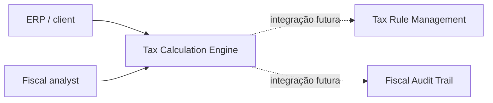
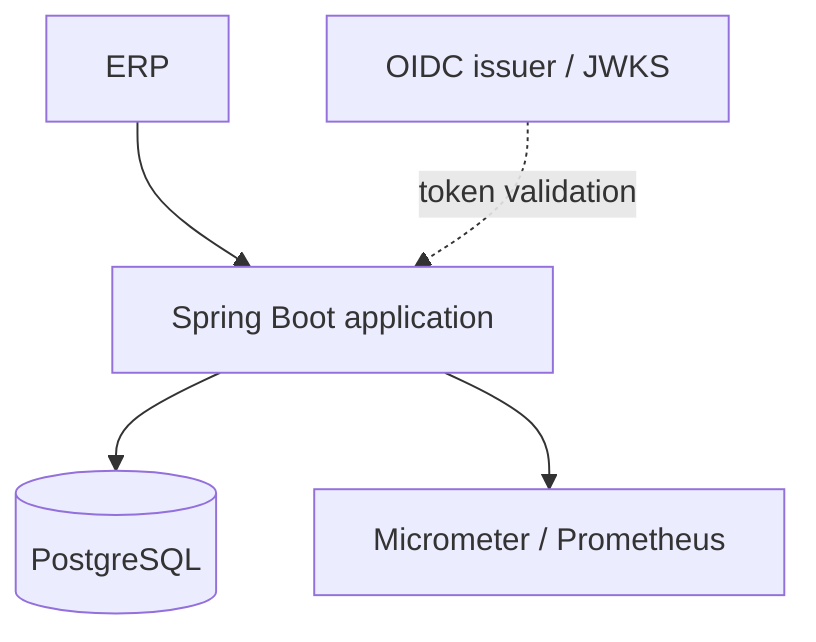
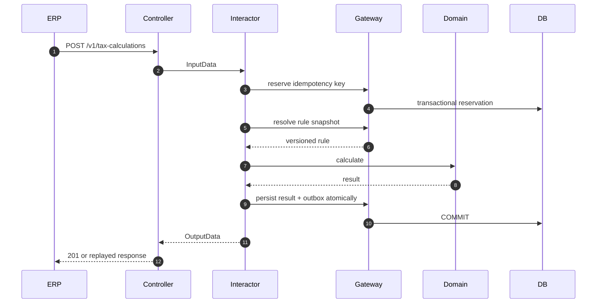

# Nomad Tax Calculation Engine

**Repositório:** [github.com/charlespaivadeveloper/nomad-tax-calculation-engine](https://github.com/charlespaivadeveloper/nomad-tax-calculation-engine)

!!! warning "Atenção — especificação, não implementação"
    Este repositório é um **starter de especificação e arquitetura**, não um motor implementado ou certificado. As taxas nos fixtures são **sintéticas**. Não usar para decisões fiscais reais — regras oficiais requerem mapeamento de fonte legal e validação por especialista fiscal. As metas de desempenho (P95 ≤ 150 ms a 100 RPS) são aspiracionais e não foram medidas. Os módulos `backend/*` são **placeholders vazios** — a implementação está pendente.

---

## Problema

ERPs com lógica fiscal fragmentada entre serviços carecem de versionamento de regras, rastreabilidade de cálculos e testabilidade determinística. Este projeto especifica e arquiteta um motor de cálculo centralizado, determinístico e auditável para CBS/IBS — com isolamento de tenant via OAuth2 e registro atômico de resultados.

O MVP proposto **exclui explicitamente:** emissão de NF-e/NFS-e, integração com autoridades fiscais brasileiras, parcelamento de pagamentos e homologação fiscal real.

---

## Arquitetura

Monólito modular com Clean Architecture (quatro módulos Maven: `tax-domain`, `tax-usecases`, `tax-interface-adapters`, `tax-frameworks`). Comunicação com clientes via REST síncrono (ADR-006).

**Contexto (C4 Level 1):**



**Containers (C4 Level 2):**



**Sequência — cálculo de imposto:**



---

## Stack (target — não implementada)

Java 21 · Spring Boot 3 · PostgreSQL · Flyway · OpenAPI 3 · JUnit 5 · Testcontainers · ArchUnit · Micrometer · OAuth2/OIDC

---

## Como rodar (fase de especificação)

Este repositório usa Claude Code como ambiente de desenvolvimento guiado. Os comandos abaixo aplicam o workflow BMAD/REA:

```bash
unzip nomad-tax-calculation-engine.zip
cd nomad-tax-calculation-engine
claude
```

Dentro do Claude Code:

```text
/nomad:status               — estado atual das histórias e gates
/nomad:study TAX-001        — estudo de requisitos da história
/nomad:spec TAX-001         — especificação (SDD)
/nomad:review TAX-001       — revisão da especificação
/nomad:gate G2              — verificação do gate de arquitetura
```

Após aprovação do G2 e confirmação de autorização de implementação:

```text
/nomad:build TAX-001
/nomad:test TAX-001
/nomad:check TAX-001
/nomad:ready TAX-001
/nomad:next
```

---

## Decisões e trade-offs (ADRs)

| ADR | Decisão | Status |
|---|---|---|
| ADR-001 | Monólito modular — extrair serviços somente quando necessidade medida justificar | Proposta (revisão em G2) |
| ADR-002 | BigDecimal from strings; scale e arredondamento explícitos; domínio puro determinístico | Proposta (revisão em G2) |
| ADR-003 | Regras versionadas por data de vigência | Proposta |
| ADR-004 | PostgreSQL como banco único do MVP | Proposta |
| ADR-005 | Transactional Outbox para auditoria atômica | Proposta |
| ADR-006 | REST síncrono — sem mensageria no MVP | Proposta |
| ADR-007 | Boundary sintético — separação explícita entre cálculo e regras de negócio | Proposta |
| ADR-008 | Clean Architecture — quatro círculos mapeados em módulos Maven | Proposta |

Todos os ADRs têm status "Proposta em G1; revisão de evidência em G2". Nenhum foi ratificado com código produzido.

---

## Limitações

- `backend/*` são placeholders vazios — nenhum código de produção existe ainda.
- Taxas e fixtures são sintéticos; qualquer semelhança com tabelas fiscais reais é coincidência.
- Metas de desempenho (P95 ≤ 150 ms a 100 RPS) não foram medidas e são aspiracionais.
- Sem homologação com autoridades fiscais brasileiras (SEFAZ, Receita Federal).
- O workflow BMAD/REA requer Claude Code instalado localmente para executar os slash commands.
