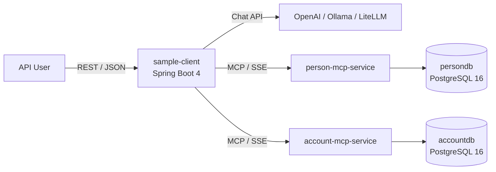

# Spring AI MCP Clean

**Repositório:** [github.com/charlespaivadeveloper/spring-ai-mcp-clean](https://github.com/charlespaivadeveloper/spring-ai-mcp-clean)

---

## Problema

Demonstrar a integração entre Spring AI 2.x e Model Context Protocol (MCP) aplicando Clean Architecture (Hexagonal / Ports & Adapters). O sistema expõe operações de domínio como AI tools e as orquestra via gateway REST com IA, mantendo a lógica de negócio desacoplada da integração com o modelo.

---

## Arquitetura

Três módulos independentes:

| Módulo | Porta | Responsabilidade |
|---|---|---|
| `person-mcp-service` | 8060 | Servidor MCP — domínio Person |
| `account-mcp-service` | 8040 | Servidor MCP — domínio Account |
| `sample-client` | 8080 | Gateway REST que usa ChatClient para invocar MCP tools via AI |



**Clean Architecture por serviço MCP — quatro círculos:**

```
interfaceadapters/mcp/          ← @Tool — entry point para tool calls do AI
usecases/                       ← Use Cases e ports (interfaces)
entities/                       ← Agregados, Value Objects, Exceções
interfaceadapters/persistence/  ← Repository Adapter + Spring Data JPA
frameworks/                     ← Spring Boot entry point
```

### MCP Tools expostos

**person-mcp-service**

- `getPersonById(id)` — busca pessoa por identificador único
- `getPersonsByNationality(nationality)` — lista pessoas por nacionalidade
- Prompt `persons-by-nationality` — template de prompt carregável pelo cliente via protocolo MCP

**account-mcp-service**

- `findAccountsByPersonId(personId)` — lista contas de uma pessoa

### REST Endpoints (sample-client)

| Método | Caminho | Descrição |
|---|---|---|
| GET | `/api/v1/persons/nationality/{nationality}` | AI query: pessoas por nacionalidade |
| GET | `/api/v1/persons/count-by-nationality/{nationality}` | AI reasoning: contagem de pessoas |
| GET | `/api/v1/persons/count-by-nationality-from-server/{nationality}` | AI com prompt carregado do servidor MCP |
| GET | `/api/v1/accounts/count-by-person/{personId}` | AI query: contagem de contas |
| GET | `/api/v1/accounts/balance-by-person/{personId}` | AI aggregation: saldo total |

---

## Stack

| Componente | Versão |
|---|---|
| Java | 21 |
| Spring Boot | 4.1.2 |
| Spring AI | 2.0.2 |
| PostgreSQL | 16 |
| Flyway | 10.20.1 |
| MapStruct | 1.6.3 |
| Lombok | 1.18.34 |
| Testcontainers | 1.20.3 |
| Helm | 3.x |
| KinD | latest |

**AI providers suportados:** OpenAI (padrão) · Ollama (local) · LiteLLM gateway

**Qualidade de código:** Checkstyle · SpotBugs · PMD · JaCoCo (cobertura mínima 70 %) · SonarCloud

---

## Como rodar

**Pré-requisitos:** Java 21+, Maven 3.8+, Docker Desktop (≥ 6 GB RAM), KinD, Helm, OpenAI API key **ou** Ollama.

=== "OpenAI (padrão)"

    ```bash
    ./deploy-all.sh --openai-key sk-xxxxxxxx
    # ou via variável de ambiente
    OPENAI_API_KEY=sk-xxxxxxxx ./deploy-all.sh
    ```

=== "Ollama (host)"

    ```bash
    ollama pull llama3.1
    ./deploy-local-ollama.sh
    # modelo personalizado: ./deploy-local-ollama.sh --ollama-model mistral
    ```

=== "Full in-cluster (Ollama + LiteLLM + Kong)"

    Requer Docker Desktop com ≥ 8 GB RAM.

    ```bash
    ./deploy-local-gateway.sh
    # todo o tráfego roteado via Kong em http://localhost:8000
    ```

Cada script: cria cluster KinD `spring-ai-mcp`, compila com Maven (`mvn package -DskipTests`), constrói imagens Docker, as carrega no KinD e faz deploy via Helm.

**Health checks:**

```bash
curl http://localhost:8060/actuator/health  # person-mcp-service
curl http://localhost:8040/actuator/health  # account-mcp-service
curl http://localhost:8080/actuator/health  # sample-client
```

**Exemplos de consulta:**

```bash
curl http://localhost:8080/api/v1/persons/nationality/Germany
curl http://localhost:8080/api/v1/accounts/balance-by-person/1
```

**Testes:**

```bash
mvn verify                           # unit + integration (requer Docker para Testcontainers)
mvn verify -pl person-mcp-service   # módulo específico
```

**Teardown:**

```bash
helm uninstall spring-ai-mcp -n spring-ai-mcp
kind delete cluster --name spring-ai-mcp
```

---

## Decisões e trade-offs

**Clean Architecture isola domínio da integração com Spring AI**
A troca de AI provider (OpenAI → Ollama → LiteLLM) não afeta use cases nem entities. O `ChatClient` e os `@Tool` adapters absorvem a variação.

**MCP como adapter de interface**
Cada `@Tool` é um entry point de interface (camada `interfaceadapters/mcp/`), não lógica de negócio. Use cases e entities desconhecem o protocolo MCP.

**Deploy via Helm/KinD**
Reprodutível localmente sem cloud, mas exige Docker Desktop com memória alocada (≥ 6 GB para o caso base, ≥ 8 GB para o full in-cluster).

---

## Limitações

- Requer Docker Desktop com ≥ 6 GB RAM (8 GB para a opção full in-cluster com Kong).
- Dependência de OpenAI API key ou Ollama instalado localmente para funcionar.
- O prompt `persons-by-nationality` retorna fallback ("MCP server prompt not available") se o servidor MCP não estiver acessível no momento da chamada.
